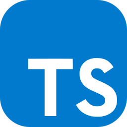
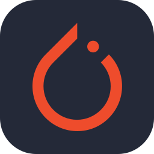
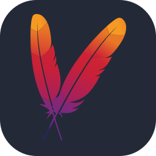

<!-- Minimal accent mark: a subtle GDGoC-inspired color rhythm, not an official GDG logo. -->

# Phu Quy Dam

**Backend Developer** · Java / Spring Boot · System Design

I'm a student at **The University of Danang – University of Science and Technology**, building backend applications with a focus on clear APIs, thoughtful data models, and systems that are easier to operate and maintain.

I'm especially interested in the decisions behind an application: how data flows, where complexity belongs, and what happens beyond the happy path.

[Email](mailto:phuquydam06@gmail.com) · [GitHub](https://github.com/DamPhuQuy)

---

### Experience

#### [Google Developer Groups on Campus - DUT](https://github.com/dscdut)
> **Vice Leader of AI Department** • *Sep 2026 – Present*  
> AI Application Developer & manage more than 10+ people, organize to share new things
> 
> **Backend Developer** • *Sep 2025 – Sep 2026*  
>  TypeScript &nbsp;|&nbsp;  Java &nbsp;|&nbsp;  Python &nbsp;|&nbsp; Agile/Scrum

#### [Artificial Intelligence DUT Club](https://github.com/DUT-AI)
> **Project Developer & Trainer** • *Oct 2026 – Present*
> Develop products & organize to share new interesting things
> 
> **AI Application Developer** • *Sep 2025 – Oct 2026*  
>  TypeScript &nbsp;|&nbsp;  Python &nbsp;|&nbsp;  ML/DL &nbsp;|&nbsp; RAG
---

### Engineering toolkit

| Area | Toolkit & Technology |
| :--- | :--- |
| **Backend** |  Java (Spring Boot) &nbsp;·&nbsp;  Python (FastAPI) &nbsp;·&nbsp;  Typescript (Nestjs) &nbsp;·&nbsp;  Ruby (Rails) |
| **Data** |  PostgreSQL &nbsp;·&nbsp;  Redis |
| **Infrastructure** |  Docker &nbsp;·&nbsp;  Maven &nbsp;·&nbsp;  Gradle |
| **Exploring** |  Python &nbsp;·&nbsp;  PyTorch &nbsp;·&nbsp; RAG &nbsp;·&nbsp; AI Agents &nbsp;·&nbsp; System Design |

---

### What I'm learning

I'm working toward a deeper understanding of **backend architecture, distributed systems, database internals, and reliable delivery**. I enjoy turning those ideas into projects I can build, break, measure, and improve.

Thanks for stopping by. You can reach me at [phuquydam06@gmail.com](mailto:phuquydam06@gmail.com).
