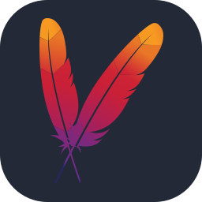

<!-- Minimal accent mark: a subtle GDGoC-inspired color rhythm, not an official GDG logo. -->

# Phu Quy Dam

**Backend Developer** · Java / Spring Boot · System Design

I'm a student at **The University of Danang – University of Science and Technology**, building backend applications with a focus on clear APIs, thoughtful data models, and systems that are easier to operate and maintain.

I'm especially interested in the decisions behind an application: how data flows, where complexity belongs, and what happens beyond the happy path.

[Email](mailto:phuquydam06@gmail.com) · [GitHub](https://github.com/DamPhuQuy)

---

### Experience

- **[Google Developer Groups on Campus - DUT](https://github.com/dscdut)**

    - Working as Backend Developer and AI Application Developer

    -  TypeScript ·  Java ·  Python · Agile/Scrum

- **[Artificial Intelligence DUT club](https://github.com/DUT-AI)**

    - Working as AI Application Developer

    -  TypeScript ·  Python ·  ML/DL · RAG

---

### Engineering toolkit

| Area               | Tools & technologies                            |
| :----------------- | :---------------------------------------------- |
| **Backend**        |       Java (Spring Boot) · Python (FastAPI) · Ruby (Rails) |
| **Data**           |   PostgreSQL · Redis |
| **Infrastructure** |     Docker · Maven · Gradle · GitHub Actions |
| **Exploring**      |   Python · RAG · AI agents · System design |

---

### What I'm learning

I'm working toward a deeper understanding of **backend architecture, distributed systems, database internals, and reliable delivery**. I enjoy turning those ideas into projects I can build, break, measure, and improve.

Thanks for stopping by. You can reach me at [phuquydam06@gmail.com](mailto:phuquydam06@gmail.com).
